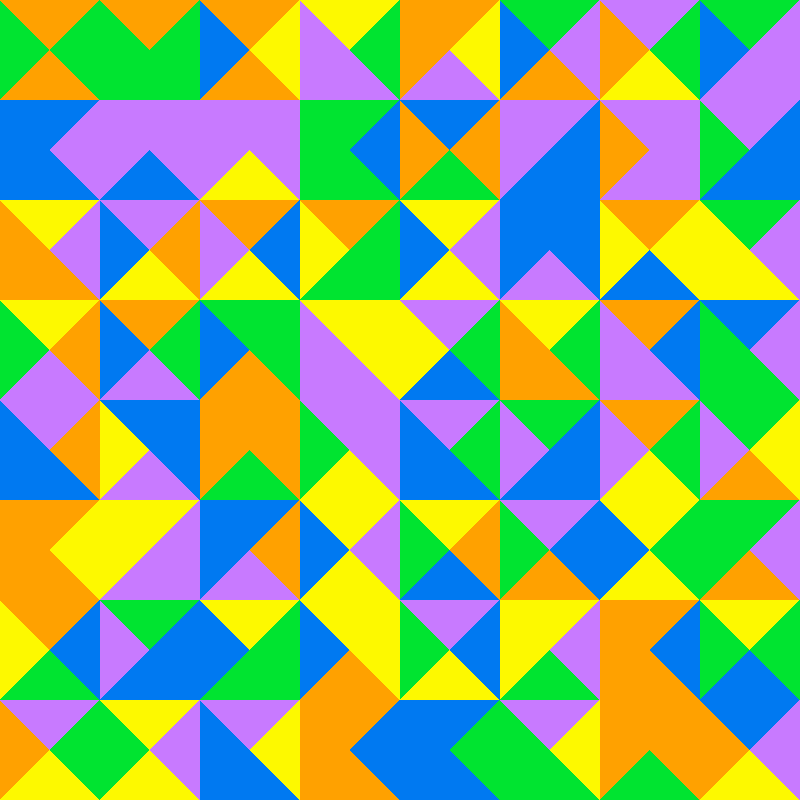
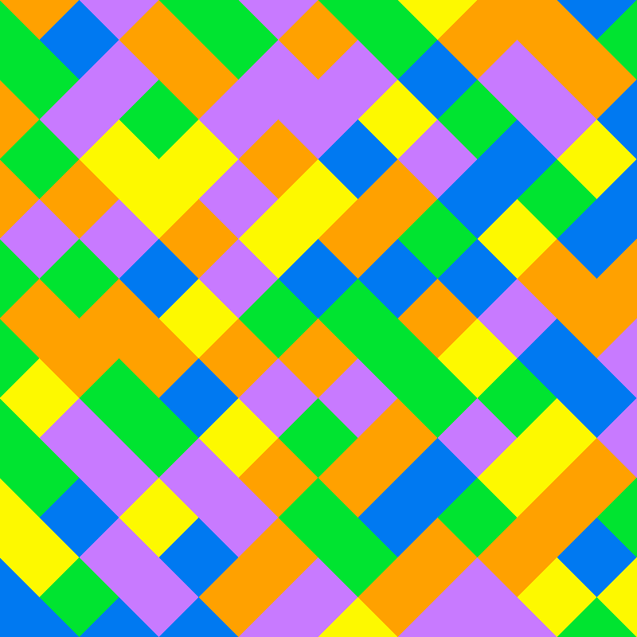

Just an experiment with C

I clicked on [a video by tsoding on programming wang tiles](https://www.youtube.com/watch?v=IGTuv_KKLFs)
and decided I'd give it a go myself and code it in C (and [raylib](https://www.raylib.com/)!) without internet

|  |  |  |
|-|-|-|

